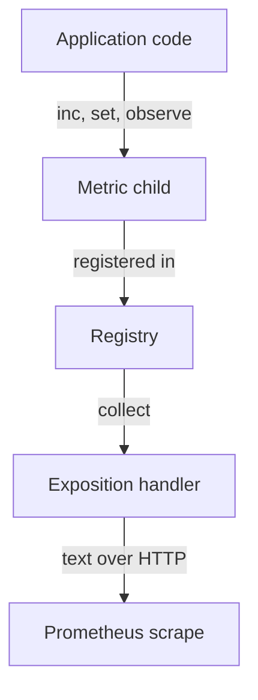

# Registries, Metric Families And Label Children

A real application defines many metrics, in many packages, and exposes them through one endpoint. The library needs a place to keep them and a rule for what happens when two definitions collide. That place is the registry. Understanding it explains the most common instrumentation bugs: duplicate registration errors, an endpoint that is healthy but empty, and memory that grows with every new label value.

## Registry, Collector And Metric Family

A registry is an object that holds collectors and produces the exposition output. A collector is an object that, when asked, returns metrics. A counter or gauge that you create is a simple collector. A custom collector can compute values when it is asked, for example by reading a file.

A metric family is the group of samples that share one metric name and one type. The family has a name, a help string, a type and a set of label keys. For a histogram, the family contains the `_bucket`, `_sum` and `_count` samples. When the registry builds the output, it asks every collector for its families and writes them out.

Each family has a contract: the same name must always have the same type and the same label keys. Two collectors that return the same name with different label keys, or with different types, break that contract, and the output would no longer be valid for Prometheus.

## Registration

Creating a metric object and registering it are two steps in some libraries and one step in others. In Go, `prometheus.NewCounter` creates the object and `MustRegister` adds it to a registry. The helper `promauto` does both. In Python, creating `Counter(...)` registers it in the default registry unless you pass another registry.

Registration is where the library checks the contract. If a family with the same name is already registered with an incompatible definition, registration fails. Go returns an error, or panics when you use `MustRegister`. Python raises an exception that says the timeseries is duplicated. This is useful: it finds the collision when the program starts, not when a dashboard shows nonsense.

## Register Once, At Start-up

The usual cause of a duplicate registration error is creating a metric inside a function that runs many times, such as a request handler. The first call registers the family. The second call tries to register it again and fails.

Create each metric once, at program start or in a package-level variable, and reuse the object. The request handler then only updates the existing object. This also removes the cost of building and registering a metric for every request.

A second cause is a test suite that creates the same metric in several tests against the global default registry. The metrics survive between tests. The fix is to give each test its own registry.

## Separate Registries

The default registry is a process-wide global. It is convenient, but every package that registers into it shares one namespace. A library you import can register metrics there, and its names can collide with yours.

Create your own registry when you want explicit control. A registry per test isolates the tests. A registry per component lets you expose different sets of metrics on different endpoints, for example application metrics on one port and administrative metrics on another.

The rule that follows is simple and a frequent source of mistakes: the exposition handler must serve the registry that you updated. If code updates metrics in registry A and the HTTP handler serves registry B, the endpoint answers with status 200 and valid text, but the application metrics are missing. Prometheus shows the target as up, and no query returns your series.

## Label Children

A metric with labels is a parent object. Each distinct combination of label values is a child, and each child holds its own value. In the exposition output, each child becomes one series.

In Python, `counter.labels(status="success")` returns the child for that value, creating it on first use. In Go, `WithLabelValues("success")` does the same. The child is stored inside the parent for the life of the process.

This storage has two consequences. First, the memory used by the application grows with the number of children. Second, every child becomes a series on every scrape, so the work of Prometheus grows as well. An unbounded label value, such as a user identifier or a request identifier, creates a new child for each new value and never releases it. The library does not remove children when a request ends.

## Removing And Initializing Children

Libraries provide explicit operations for children. You can remove one child, for example `remove` in Python or `DeleteLabelValues` in Go, and you can clear all children of a metric. Use removal for children that represent a thing that is gone, such as a closed connection pool or a deleted tenant.

You can also create the children you know you will need at start-up. A counter with `status` values `success` and `error` should have both children from the first scrape. Then a query for the error rate returns zero before the first error, instead of returning no data.

The difference matters. A missing series means that no measurement exists, for example because the code never ran or the target was down. A series with the value zero means that the code ran and counted nothing. Queries and alerts treat these cases differently, so create zero-valued children for small, fixed sets of label values.

## A Diagram Of The Path

The diagram shows how an update becomes a scraped sample.

The registry sits between the metrics and the handler, and the handler only sees what is in the registry that it serves.

## Choose Labels That Stay Bounded

Label values should come from a small set that you can list in advance, such as the HTTP method, a normalized route template, or an outcome class. A route template like `/orders/{id}` is bounded. The raw path `/orders/918273` is not.

A good test is to estimate the number of children: multiply the number of values of each label. A metric with 5 methods, 20 routes and 4 status classes has up to 400 children. Adding a label with thousands of values multiplies that figure. The application must keep the number of children bounded.

Do not put sensitive data in label values either. Label values appear in the endpoint output, in Prometheus storage and in dashboards. An email address or a token in a label is exposed to everyone who can read metrics.

## Custom Collectors

Sometimes the value you want already exists somewhere else, such as a queue length in a database or a file size on disk. A custom collector reads that value when the scrape happens and returns it as a metric. In Go you implement the `Describe` and `Collect` methods. In Python you implement a class with a `collect` method and register it.

The collector runs inside the scrape request, so a slow read makes the scrape slow. Keep the work small, set timeouts on any outside call, and never let a collector block forever. Return a fresh value each time instead of caching an old one that looks current.

## What You Know Now

You know that the registry owns the collectors, that registration enforces the family contract, and that metrics must be created once and served by the right registry. You know that every label combination is a child that stays in memory, and that a missing series differs from a zero. The remaining question is what happens to these values when the process restarts, when several processes serve one port, and when a scrape runs at the same time as updates.

## Common pitfalls

> [!WARNING]
> Creating a metric inside a request handler causes duplicate registration. Updating one registry while serving another gives a healthy endpoint with missing metrics. Label children are never removed automatically, so an unbounded label grows memory until the process fails.
