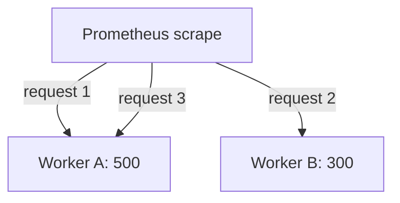

# Process Lifecycle, Multiple Workers And Safe Collection

A metric value lives in the memory of one process. That fact explains why values reset, why short programs can lose their last updates, why servers with several worker processes can show only part of the truth, and why a slow metrics handler can hurt the application. This chapter follows a metric through these situations.

## Counters Reset When The Process Restarts

A counter starts at zero when the process starts. When the process restarts after a crash or a deployment, the counter returns to zero. The application does not save counters to disk, and it should not. Saving would add cost and new failure modes, and it is not needed.

Prometheus handles this in the query layer. The functions `rate()` and `increase()` detect a drop in a counter value between two samples and treat it as a reset. They continue the calculation as if the counter had restarted from zero. A graph of the rate therefore stays smooth across a restart.

The raw counter value is a different matter. Reading `requests_total` directly after a restart shows a small number, which does not mean that traffic fell. Always apply `rate()` or `increase()` to a counter before you interpret it.

## Gauges And Timestamps After A Restart

A gauge is set by the application, so after a restart it holds whatever the new process sets. A queue-depth gauge that the new process reads from the queue is correct immediately. A gauge that only the previous process updated, such as the time of the last success, is zero or missing until the new process has done the work again.

Because of this, a common metric for batch-like work is a timestamp gauge, for example `last_success_timestamp_seconds`. It holds the Unix time, in seconds, of the last successful run. The query `time() - last_success_timestamp_seconds` returns the seconds since that run. If the process restarts, the value is absent until the next success, and the alert must handle that case on purpose.

## Short-Lived Processes

Prometheus pulls metrics. It can scrape a process only while the process runs and serves HTTP. A program that runs for two seconds and exits may finish before the next scrape, so its final values are never collected.

There are two common answers. The first is to keep a long-running supervisor that exposes the results of the short jobs. The second is to push the results to a Pushgateway, a small service that stores pushed metrics and exposes them for scraping. Each choice has limits, and the library alone does not solve the problem. The important point for this chapter is that a counter in a process that exits cannot be read afterwards.

## Several Processes Behind One Port

Some servers run several worker processes. Python servers such as Gunicorn commonly do this, because of the global interpreter lock. Each worker has its own memory and therefore its own registry. A request for `/metrics` reaches one worker, chosen by the server, and that worker answers with only its own values.

The result is confusing. Two consecutive scrapes can show different counter values, and a counter can appear to go backward, because different workers answered. Prometheus then sees false resets.

The Python client library supports a multiprocess mode for this case. Workers write their metric values into files in a directory named by the environment variable `PROMETHEUS_MULTIPROC_DIR`, and the process that serves `/metrics` reads all the files and combines them. Gauges need a rule for combining values, because adding the memory use of several workers is different from taking the largest one. The library lets you choose a mode per gauge, such as sum of live processes, maximum or minimum.

Other languages solve the problem differently. Go and Java programs usually run one process with many threads, so one registry is enough. Read the documentation of your library before you assume that it supports multiple processes.

## Concurrent Updates And Scrapes

A scrape can arrive while threads update metrics. The library designers made the standard operations thread safe: increments, sets and observations are safe to call from many threads, and collection reads a consistent value for each sample. Use only these operations.

A histogram is an important case. One observation updates a bucket, the sum and the count. Libraries take care that a scrape does not report a half-updated histogram in a harmful way, but the values of different series are still read at slightly different instants. Treat a rate calculated from `_sum` and `_count` as an estimate over a window, not as an exact snapshot.

## Keep The Scrape Cheap

The `/metrics` handler runs on every scrape, often every 15 or 30 seconds, from every Prometheus server that targets it. Work done in the handler is paid again and again.

Avoid slow calls inside custom collectors, such as a database query that takes seconds. If the scrape takes longer than the scrape timeout, Prometheus marks the target as failed, `up` becomes 0, and the application metrics for that interval are lost. A slow collector can also add load to the application and the database it queries.

When a value is expensive to compute, compute it in a background task on its own schedule and store the result in a gauge. The collector then returns the stored value immediately. Add a gauge with the time of the last update so that a stuck background task is visible.

## Failure Cases To Test

Before you trust an instrumented service, test three failures on purpose. Restart the process and confirm that the rate of a counter stays continuous. Stop a dependency and confirm that the error counter increases and that the handler still answers within the scrape timeout. Send a burst of requests and confirm that the in-progress gauge returns to zero afterwards.

Each test checks one assumption from this chapter, and each failure it finds is cheaper to fix before production than after.

## Check What You Expose

Expose only what you need. Each series costs memory in the application and storage in Prometheus. Remove debug metrics that nobody uses. Do not put secrets, personal data or internal addresses into metric names or label values.

Restrict who can read the endpoint. Metrics reveal route names, library versions and traffic patterns. Serve the endpoint on a port that is not public, or protect it with transport security and authentication.

## Worked Example: A Restart In Numbers

Prometheus scrapes a counter at four moments and stores these values: 100, 160, 5 and 65. The third value is lower than the second one, so the library function `increase()` treats it as a reset. It assumes the counter restarted at zero and counted 5 events before the scrape, so the increase between the second and third scrapes is counted as 5.

The total increase over the four samples is therefore 60 plus 5 plus 60, which is 125. A direct subtraction of the last value from the first would give minus 35, which is wrong. This is why a counter must always pass through `rate()` or `increase()`. One limit remains: events that happened between the last scrape before the crash and the crash itself are lost, because no scrape recorded them.

## Worked Example: Two Workers

A server runs two workers. Worker A has handled 500 requests and worker B has handled 300. Prometheus scrapes three times, and the answers come from A, B and A. The stored counter values are 500, 300 and 510.

Prometheus reads 500 then 300 as a reset, then 300 then 510 as growth of 210. The calculated increase is far higher than the real traffic. Nothing is wrong with the workers. The endpoint answered from a different registry on every scrape. Multiprocess support, or one scrape target for each worker, removes the problem.

The diagram shows that consecutive scrapes reach different workers, and each worker answers only with its own counter.

## What You Know Now

You know that values live in process memory, that `rate()` handles counter resets, and that short-lived processes and multi-worker servers need a special design. You also know that collection must be cheap and safe. A parseable endpoint proves that the format is right. It does not prove that the numbers describe the work, so the last step is always to compare the metrics with a known amount of traffic.

## Common pitfalls

> [!WARNING]
> Reading a raw counter after a restart suggests that traffic dropped. Exposing only one worker of several shows partial values that look valid. A custom collector that makes slow calls can time out the scrape and make the target look down.
