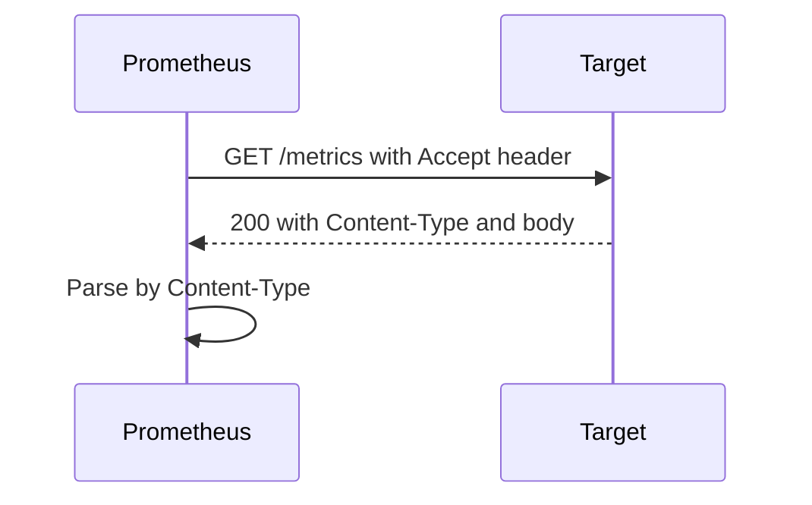

# The Text Exposition Format And Format Negotiation

A target and Prometheus must agree on the bytes of a response. The agreement is a text format that both humans and programs can read. If one line of the response breaks the rules, Prometheus can reject the whole scrape. This chapter explains each element of the format, the newer OpenMetrics variant and the way the two sides choose a format.

## The Shape Of A Response

A response is plain text, encoded as UTF-8, with one entry per line. The content type of the classic format is `text/plain; version=0.0.4`. Lines starting with `#` are comments, and two kinds of comment carry meaning: `# HELP` and `# TYPE`. Every other line is a sample.

```text
# HELP shop_orders_total Orders created.
# TYPE shop_orders_total counter
shop_orders_total{channel="web"} 1027
shop_orders_total{channel="mobile"} 643
# HELP shop_queue_depth Orders waiting for packing.
# TYPE shop_queue_depth gauge
shop_queue_depth 12
```

This sample shows two families. The `# HELP` line holds a one-line description, and the `# TYPE` line holds one of `counter`, `gauge`, `histogram`, `summary` or `untyped`. These lines appear once per family, before its first sample.

## Sample Lines

A sample line has the form `name{label="value",...} value [timestamp]`. The name matches the regular expression `[a-zA-Z_:][a-zA-Z0-9_:]*`. Colons are reserved for recording rules that users write in Prometheus, so instrumentation does not use them.

Label names match `[a-zA-Z_][a-zA-Z0-9_]*`, and names that start with two underscores are reserved for internal use. Label values are strings in double quotes. Inside a label value, a backslash, a double quote and a line feed must be written as `\\`, `\"` and `\n`.

The value is a float. The special values `NaN`, `+Inf` and `-Inf` are valid. An optional timestamp, in milliseconds since the Unix epoch, may follow the value. Instrumented applications normally leave it out, so that Prometheus records the scrape time. A timestamp in the response is an advanced feature, and misusing it can create gaps or stale data.

## Rules That Break A Scrape

Prometheus is strict about format. A line that cannot be parsed makes the scrape fail, and the target is marked as down for that interval. Common causes are an invalid number such as `twelve`, a label value that is not escaped, a missing line feed at the end of the body, or two samples with the same name and the same label set.

A family must also be consistent. All lines of a family are grouped, and the family has one `# TYPE` line. Writing the same metric name with two types is invalid. Using the library avoids these errors, which is a strong reason not to build the text by hand.

## Histogram And Summary Lines

A histogram family has lines named with the suffixes `_bucket`, `_sum` and `_count`, and the `# TYPE` line uses the base name, without a suffix. The bucket lines carry the `le` label and must be in increasing order of the bound, ending with `le="+Inf"`. A summary family has lines with the `quantile` label, followed by `_sum` and `_count`.

## OpenMetrics

OpenMetrics is a specification that grew out of the Prometheus text format and adds features. Its content type is `application/openmetrics-text`. Several differences matter for the exam.

- The response must end with a line `# EOF`. This lets the scraper detect a truncated response.
- Counter samples must have the suffix `_total`, and the `# TYPE` line uses the name without it.
- A counter can have a `_created` sample that holds the Unix time when the counter was created, which helps detect resets.
- Units can be declared with a `# UNIT` line.
- Samples can carry exemplars, which attach a trace identifier to an observation.

The classic format has no `# EOF` line. A parser for OpenMetrics rejects a response that lacks it.

## Choosing A Format

The scraper and the target agree through HTTP content negotiation. Prometheus sends an `Accept` header that lists the formats it supports, in order of preference. The target answers with the first format that it can produce, and states it in the `Content-Type` response header.

Prometheus then parses the body with the parser for that content type. The setting `scrape_protocols` in a scrape configuration controls the order that Prometheus asks for. A target that supports only the classic format still works, because the classic format is always acceptable. The client library handler does the negotiation for you.



The diagram shows that the target chooses the format from the `Accept` header, and Prometheus parses the body according to the response `Content-Type`.

## Look At Both Formats Yourself

You can ask for a specific format with a request header and compare the output. A command such as `curl -H "Accept: application/openmetrics-text" http://host:port/metrics` against a library-based service returns the OpenMetrics form, with `# EOF` at the end, if the library supports it. The playground endpoint writes the classic format only, and the exercise explains how to read it.

## Untyped And Missing Metadata

A family without a `# TYPE` line is treated as untyped. Prometheus still stores the samples, but tools cannot tell a counter from a gauge, and the function suggestions in a query editor are less useful. A missing `# HELP` line is allowed but leaves the reader without a description.

Always write both lines for every family. Libraries do this for you, and hand-written exporters often forget it.

## What You Know Now

You can read every line of an endpoint response, spot the lines that break a scrape and explain what changes in OpenMetrics. You know that the target picks the format from the `Accept` header and that the body is parsed according to `Content-Type`. The remaining skill is practice: reading a live endpoint and checking each family against what you expect.

## Common pitfalls

> [!WARNING]
> One invalid line fails the whole scrape. A missing `# EOF` line breaks an OpenMetrics response, while the same body is valid in the classic format. A timestamp in the response overrides the scrape time and can create gaps, so leave it out unless you have a reason.
